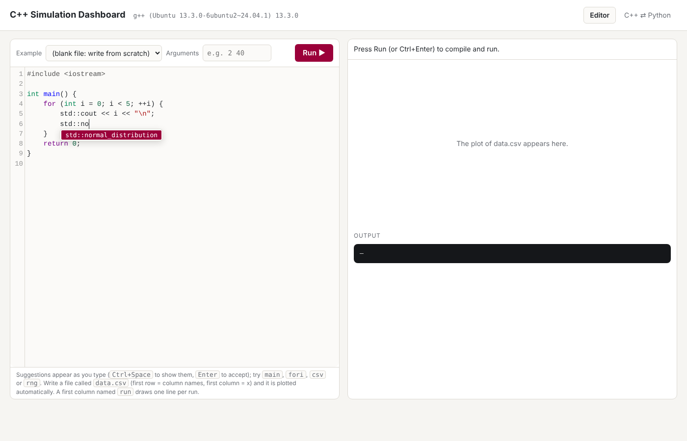
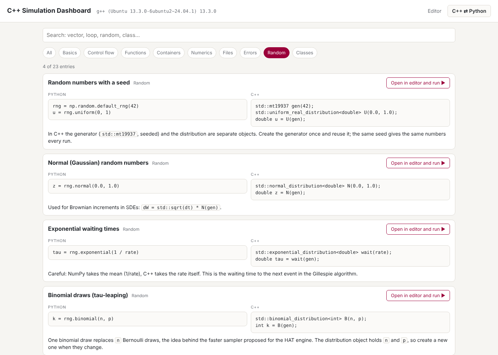
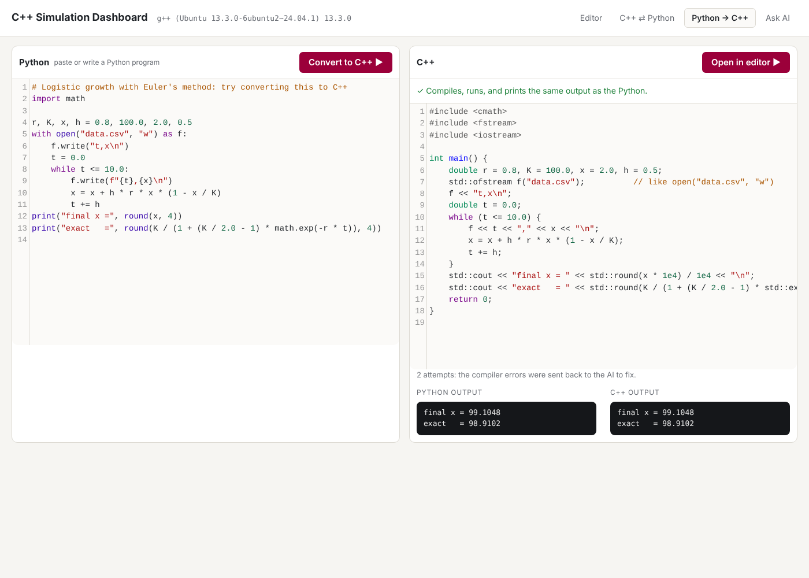
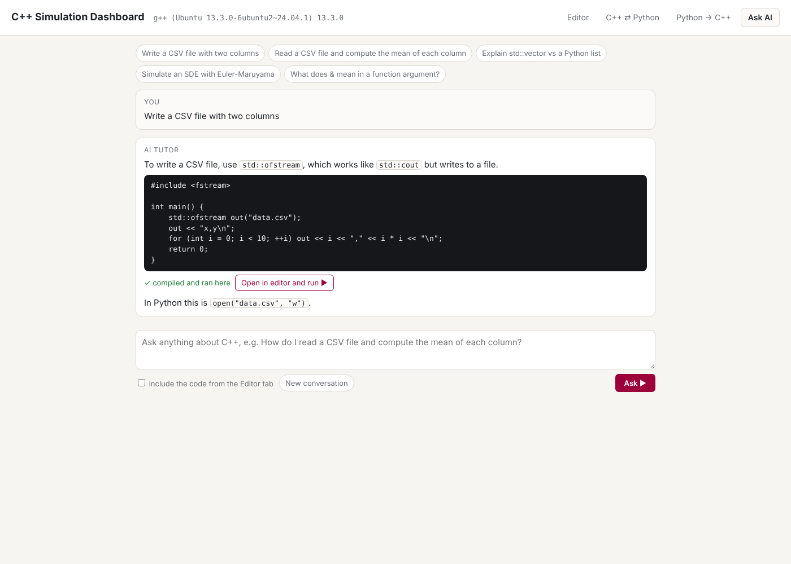

# C++ Simulation Dashboard

Write C++ in your browser, press **Run**, and see the program's output and a plot of its results straight away. Built for learning and teaching **numerical simulation in C++**: ODEs, SDEs and stochastic epidemic models.


## What it does

1. You write C++ in the editor, from a blank file or an example: syntax highlighting, line numbers, automatic closing brackets, and **suggestions while you type** (`Ctrl+Space`), including snippets such as `main`, `fori`, `csv` and `rng`. `Ctrl+Enter` runs the code.
2. The app compiles it with **your own `g++`** (`-std=c++17 -O2 -Wall -Wextra`) and runs it.
3. It shows the compiler messages, the program's output and the compile and run times.
4. If the program writes a file called **`data.csv`**, it is plotted automatically:
   * first row = column names, first column = x, every other column = one line;
   * a first column named `run` draws one line per run (for stochastic simulations).



## C++ ⇄ Python dictionary

The **C++ ⇄ Python** tab shows 23 concepts side by side (printing, loops, functions, vectors, structs, random numbers, classes and more), each with a short note on the difference and a button that opens a full program in the editor and runs it.



Every entry is a real C++ file in `dictionary/`, and the tests compile and run all of them without warnings, so the dictionary cannot contain broken code. To add an entry, copy any file in `dictionary/` and edit it. The format is:

```cpp
// title: List of numbers -> std::vector
// category: Containers
// python:
//  x = [1.0, 2.0, 3.0]
// cpp:
//  std::vector<double> x{1.0, 2.0, 3.0};
// note: `append` is `push_back`, `len` is `.size()`.
// ---
#include <vector>
int main() { std::vector<double> x{1.0, 2.0, 3.0}; }
```

Lines after `python:`, `cpp:` and `note:` start with `//` followed by **two** spaces; the line `// ---` ends the header, and the full program follows it.

## Local AI tutor (optional)

Two more tabs use a coding model that runs **on your own computer** through [Ollama](https://ollama.com): nothing is sent to the internet.

* **Python → C++**: paste a Python program; the AI writes the C++ version, which is then compiled and run. If it does not compile, the compiler errors are sent back to the AI to fix (up to 3 attempts). The Python is run too, and the two outputs are compared.
* **Ask AI**: ask how to do something in C++ ("read a CSV file and compute the mean of each column"). Every complete program in an answer is compiled and run, and marked ✓ or ✗, with a button to open it in the editor.

**The AI can be wrong.** That is why nothing it writes is trusted until the compiler and the output comparison have checked it.





### Set it up (Linux, no administrator rights needed)

```
mkdir -p ~/ollama
curl -fsSL https://ollama.com/download/ollama-linux-amd64.tar.zst | tar x --zstd -C ~/ollama
echo 'export PATH="$HOME/ollama/bin:$PATH"' >> ~/.bashrc
source ~/.bashrc
ollama serve
```
Leave `ollama serve` running, and in a second terminal download the model once (about 5 GB):
```
ollama pull qwen2.5-coder:7b
```
Then start the dashboard as usual (`python app.py`). Ollama listens only on `127.0.0.1:11434`.

To use another model, set `OLLAMA_MODEL`, for example `OLLAMA_MODEL=qwen2.5-coder:14b python app.py` (better answers, slower). Without a GPU, a 7B model answers in roughly 10 to 60 seconds.

## Examples included

| Example | Model | What it shows |
|---|---|---|
| `01_hello` | Command-line arguments | How a C++ program receives input |
| `02_logistic_euler` | Logistic growth, Euler's method | Numerical vs exact solution; error vs step size |
| `03_sir_rk4` | SIR epidemic, Runge–Kutta 4 | S+I+R conserved to about 10⁻¹⁵ |
| `04_sde_euler_maruyama` | Geometric Brownian motion, Euler–Maruyama | Sample mean vs exact mean, with a 2-standard-error band |
| `05_gillespie_sir` | Exact stochastic SIR (Gillespie) | About 1/R0 of epidemics die out by chance |
| `06_lamperti_mobius_exact` | Jump-driven prevalence, exact simulation of the logit (Lamperti–Möbius conjugacy) | Monte Carlo matches the exact mean, variance and threshold probability; no time step and no clipping to (0,1) |

## Run it on your computer

You need **g++** and **Python 3**.

**Windows**
```
winget install Python.Python.3.12
```
Check that `g++ --version` works in cmd (for example from MinGW-w64 or Strawberry Perl). Then, in this folder:
```
pip install -r requirements.txt
python app.py
```
Open <http://127.0.0.1:5000> in your browser.

**Linux / macOS:** install `g++` (`sudo apt install g++`, or the Xcode command-line tools), then the same two commands.

## Tests

```
pip install pytest
python -m pytest -v
```
The tests compile real programs and check normal output, command-line arguments, compiler errors, runtime errors, a program that never stops (it is cut off after 10 s), reading `data.csv`, that every example compiles and runs, that every dictionary entry is complete and compiles without warnings, and the AI features (fix loop, output comparison, error handling), using a stand-in for the model so no AI is needed to run the tests. They run automatically on GitHub for every push (see `.github/workflows/tests.yml`).

## How it works

```
browser (static/index.html)              app.py (Flask, 127.0.0.1 only)                 your g++
  editor + Plotly chart  -- POST /api/run -->  write main.cpp in a temp folder  -->  compile
                         <-- JSON ----------   run with a time limit, read data.csv <--  run
```

* `app.py`: about 120 lines of Python. Each run uses a fresh temporary folder, deleted afterwards.
* `static/index.html`: the page. CodeMirror (editor) and Plotly (charts) are included in `static/vendor/`, so it works offline.
* `ai.py`: the local AI features: talking to Ollama, the compile-and-fix loop, running the Python, comparing outputs.
* `examples/`: the example programs. Add your own `.cpp` file there and it appears in the menu.
* `dictionary/`: the C++ ⇄ Python entries, one compilable `.cpp` file each.

## Safety

The app compiles and runs whatever code is in the editor, with your user's permissions. It listens only on `127.0.0.1`, so only your own computer can reach it. **Do not put it on a public server.**

## Licence

MIT. CodeMirror and Plotly keep their own MIT licences (`static/vendor/`).
