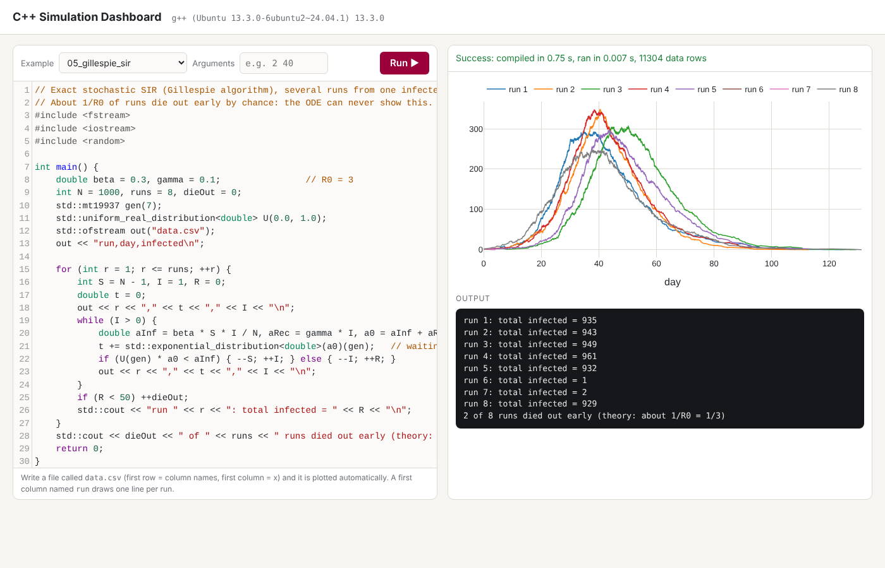

# C++ Simulation Dashboard

Write C++ in your browser, press **Run**, and see the program's output and a plot of its results straight away. Built for learning and teaching **numerical simulation in C++**: ODEs, SDEs and stochastic epidemic models.



## What it does

1. You write C++ in the editor (syntax highlighting, line numbers, `Ctrl+Enter` to run).
2. The app compiles it with **your own `g++`** (`-std=c++17 -O2 -Wall -Wextra`) and runs it.
3. It shows the compiler messages, the program's output and the compile and run times.
4. If the program writes a file called **`data.csv`**, it is plotted automatically:
   * first row = column names, first column = x, every other column = one line;
   * a first column named `run` draws one line per run (for stochastic simulations).

## Examples included

| Example | Model | What it shows |
|---|---|---|
| `01_hello` | Command-line arguments | How a C++ program receives input |
| `02_logistic_euler` | Logistic growth, Euler's method | Numerical vs exact solution; error vs step size |
| `03_sir_rk4` | SIR epidemic, Runge–Kutta 4 | S+I+R conserved to about 10⁻¹⁵ |
| `04_sde_euler_maruyama` | Geometric Brownian motion, Euler–Maruyama | Sample mean vs exact mean, with a 2-standard-error band |
| `05_gillespie_sir` | Exact stochastic SIR (Gillespie) | About 1/R0 of epidemics die out by chance |

## Run it on your computer

You need **g++** and **Python 3**.

**Windows**
```
winget install Python.Python.3.12
```
Check that `g++ --version` works in cmd (for example from MinGW-w64 or Strawberry Perl). Then, in this folder:
```
pip install -r requirements.txt
python app.py
```
Open <http://127.0.0.1:5000> in your browser.

**Linux / macOS:** install `g++` (`sudo apt install g++`, or the Xcode command-line tools), then the same two commands.

## Tests

```
pip install pytest
python -m pytest -v
```
The tests compile real programs and check normal output, command-line arguments, compiler errors, runtime errors, a program that never stops (it is cut off after 10 s), reading `data.csv`, and that every example compiles and runs. They run automatically on GitHub for every push (see `.github/workflows/tests.yml`).

## How it works

```
browser (static/index.html)              app.py (Flask, 127.0.0.1 only)                 your g++
  editor + Plotly chart  -- POST /api/run -->  write main.cpp in a temp folder  -->  compile
                         <-- JSON ----------   run with a time limit, read data.csv <--  run
```

* `app.py`: about 120 lines of Python. Each run uses a fresh temporary folder, deleted afterwards.
* `static/index.html`: the page. CodeMirror (editor) and Plotly (charts) are included in `static/vendor/`, so it works offline.
* `examples/`: the example programs. Add your own `.cpp` file there and it appears in the menu.

## Safety

The app compiles and runs whatever code is in the editor, with your user's permissions. It listens only on `127.0.0.1`, so only your own computer can reach it. **Do not put it on a public server.**

## Licence

MIT. CodeMirror and Plotly keep their own MIT licences (`static/vendor/`).
